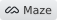
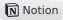
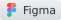
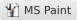
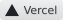

<picture><source media="(prefers-color-scheme: dark)" srcset="assets/intro-dark.svg"></picture>

Based in Toronto, I'm currently a Lead Product Designer @ <picture></picture> RBC Wealth Management, making self-directed investing approachable for everyone. Over the past several years, I've been leading design for both traditional and on-chain financial products. I work end-to-end, from defining the problem to designing the experience and getting it to a production-ready(ish) state.

<b>🛠️ Stack &amp; Workflow</b>

<table>
<tr><th align="left" valign="top">Plan</th><td><picture><source media="(prefers-color-scheme: dark)" srcset="assets/badges/figjam-dark.svg"></picture> <picture><source media="(prefers-color-scheme: dark)" srcset="assets/badges/miro-dark.svg"></picture> <picture><source media="(prefers-color-scheme: dark)" srcset="assets/badges/maze-dark.svg"></picture> <picture><source media="(prefers-color-scheme: dark)" srcset="assets/badges/usertesting-dark.svg"></picture> <picture><source media="(prefers-color-scheme: dark)" srcset="assets/badges/jira-dark.svg"></picture> <picture><source media="(prefers-color-scheme: dark)" srcset="assets/badges/confluence-dark.svg"></picture> <picture><source media="(prefers-color-scheme: dark)" srcset="assets/badges/notion-dark.svg"></picture></td></tr>
<tr><th align="left" valign="top">Design</th><td><picture><source media="(prefers-color-scheme: dark)" srcset="assets/badges/figma-dark.svg"></picture> <picture><source media="(prefers-color-scheme: dark)" srcset="assets/badges/framer-dark.svg"></picture> <picture><source media="(prefers-color-scheme: dark)" srcset="assets/badges/sketch-dark.svg"></picture> <picture><source media="(prefers-color-scheme: dark)" srcset="assets/badges/photoshop-dark.svg"></picture> <picture><source media="(prefers-color-scheme: dark)" srcset="assets/badges/ms-paint-dark.svg"></picture> <picture><source media="(prefers-color-scheme: dark)" srcset="assets/badges/claude-dark.svg"></picture> <picture><source media="(prefers-color-scheme: dark)" srcset="assets/badges/chatgpt-dark.svg"></picture></td></tr>
<tr><th align="left" valign="top">Build</th><td><picture><source media="(prefers-color-scheme: dark)" srcset="assets/badges/claude-code-dark.svg"></picture> <picture><source media="(prefers-color-scheme: dark)" srcset="assets/badges/vs-code-dark.svg"></picture> <picture><source media="(prefers-color-scheme: dark)" srcset="assets/badges/cursor-dark.svg"></picture> <picture><source media="(prefers-color-scheme: dark)" srcset="assets/badges/storybook-dark.svg"></picture> <picture><source media="(prefers-color-scheme: dark)" srcset="assets/badges/vite-dark.svg"></picture> <picture><source media="(prefers-color-scheme: dark)" srcset="assets/badges/react-dark.svg"></picture> <picture><source media="(prefers-color-scheme: dark)" srcset="assets/badges/vercel-dark.svg"></picture></td></tr>
</table>

---

<a href="https://www.maaribs.com"><picture><source media="(prefers-color-scheme: dark)" srcset="assets/badges/website-dark.svg"></picture></a> • <a href="https://www.linkedin.com/in/marib/"><picture><source media="(prefers-color-scheme: dark)" srcset="assets/badges/linkedin-dark.svg"></picture></a> • <a href="https://dribbble.com/maaribou"><picture><source media="(prefers-color-scheme: dark)" srcset="assets/badges/dribbble-dark.svg"></picture></a>
