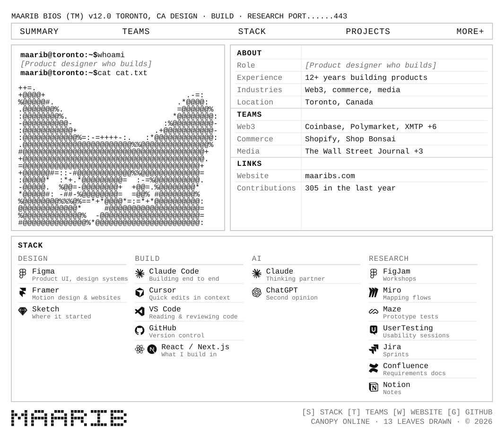

<picture><source media="(prefers-color-scheme: dark)" srcset="assets/bw-dark.svg"></picture>

### Side projects

| Project | What it is |
|---|---|
| [Canopy](https://maarib.github.io/canopy/) | Fall colors across Canada, and what to explore in Ontario |
| [Leaf icons](https://maarib.github.io/leaf-icons/) | Tree leaf icons, and a small SVG editor for their stems and layers |
| [FPL Dashboard](https://maarib.github.io/fpl-dashboard/) | Fantasy Premier League players, sortable and side by side |
| [CardCompare](https://github.com/maarib/card-compare) | Canadian credit cards compared on fees, earn rates, insurance and perks |
| [alert.engine](https://github.com/maarib/alert.engine) | A stock and ETF watchlist with alerts, market briefs and sector exposure |
| [page-comments](https://github.com/maarib/page-comments) | A Claude Code skill for leaving notes on any web page |
