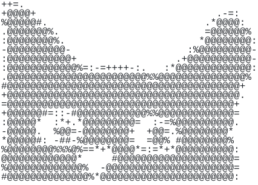

<picture><source media="(prefers-color-scheme: dark)" srcset="assets/cat-dark.svg"></picture>

```console
maarib@toronto:~$ whoami
Product designer who builds
```

### About

| | |
|---|---|
| Experience | 12+ years building products |
| Industries | Web3, commerce, media |
| Location | Toronto, Canada |
| Website | [maaribs.com](https://maaribs.com) |

### Teams

| Web3 | Commerce | Media |
|---|---|---|
| Glow Finance | Shop Bonsai | The Wall Street Journal |
| Blueprint Finance | Shopify | Decentralized Pictures |
| Coinbase |  | Complex Networks |
| Credit Coop |  | Agnitus |
| Polymarket |  |  |
| XMTP |  |  |
| Suntory |  |  |
| Goldfinch |  |  |
| Megprime |  |  |

### Stack

| | Tool | Used for |
|---|---|---|
| **Design** | <picture><source media="(prefers-color-scheme: dark)" srcset="assets/logos/figma-dark.svg"></picture> Figma | Product UI, design systems |
|  | <picture><source media="(prefers-color-scheme: dark)" srcset="assets/logos/framer-dark.svg"></picture> Framer | Motion design & websites |
|  | <picture><source media="(prefers-color-scheme: dark)" srcset="assets/logos/sketch-dark.svg"></picture> Sketch | Where it started |
| **Build** | <picture><source media="(prefers-color-scheme: dark)" srcset="assets/logos/claude-code-dark.svg"></picture> Claude Code | Building end to end |
|  | <picture><source media="(prefers-color-scheme: dark)" srcset="assets/logos/cursor-dark.svg"></picture> Cursor | Quick edits in context |
|  | <picture><source media="(prefers-color-scheme: dark)" srcset="assets/logos/vs-code-dark.svg"></picture> VS Code | Reading & reviewing code |
|  | <picture><source media="(prefers-color-scheme: dark)" srcset="assets/logos/github-dark.svg"></picture> GitHub | Version control |
|  | <picture><source media="(prefers-color-scheme: dark)" srcset="assets/logos/react-dark.svg"></picture> <picture><source media="(prefers-color-scheme: dark)" srcset="assets/logos/nextjs-dark.svg"></picture> React / Next.js | What I build in |
| **AI** | <picture><source media="(prefers-color-scheme: dark)" srcset="assets/logos/claude-dark.svg"></picture> Claude | Thinking partner |
|  | <picture><source media="(prefers-color-scheme: dark)" srcset="assets/logos/chatgpt-dark.svg"></picture> ChatGPT | Second opinion |
| **Research** | <picture><source media="(prefers-color-scheme: dark)" srcset="assets/logos/figjam-dark.svg"></picture> FigJam | Workshops |
|  | <picture><source media="(prefers-color-scheme: dark)" srcset="assets/logos/miro-dark.svg"></picture> Miro | Mapping flows |
|  | <picture><source media="(prefers-color-scheme: dark)" srcset="assets/logos/maze-dark.svg"></picture> Maze | Prototype tests |
|  | <picture><source media="(prefers-color-scheme: dark)" srcset="assets/logos/usertesting-dark.svg"></picture> UserTesting | Usability sessions |
|  | <picture><source media="(prefers-color-scheme: dark)" srcset="assets/logos/jira-dark.svg"></picture> Jira | Sprints |
|  | <picture><source media="(prefers-color-scheme: dark)" srcset="assets/logos/confluence-dark.svg"></picture> Confluence | Requirements docs |
|  | <picture><source media="(prefers-color-scheme: dark)" srcset="assets/logos/notion-dark.svg"></picture> Notion | Notes |

### Side projects

| Project | What it is |
|---|---|
| [Canopy](https://maarib.github.io/canopy/) | Fall colors across Canada, and what to explore in Ontario |
| [Leaf icons](https://maarib.github.io/leaf-icons/) | Tree leaf icons, and a small SVG editor for their stems and layers |
| [FPL Dashboard](https://maarib.github.io/fpl-dashboard/) | Fantasy Premier League players, sortable and side by side |
| [CardCompare](https://github.com/maarib/card-compare) | Canadian credit cards compared on fees, earn rates, insurance and perks |
| [alert.engine](https://github.com/maarib/alert.engine) | A stock and ETF watchlist with alerts, market briefs and sector exposure |
| [page-comments](https://github.com/maarib/page-comments) | A Claude Code skill for leaving notes on any web page |
