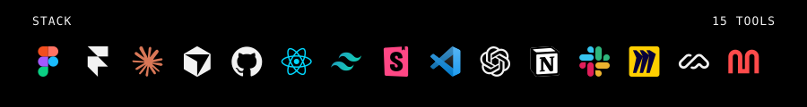
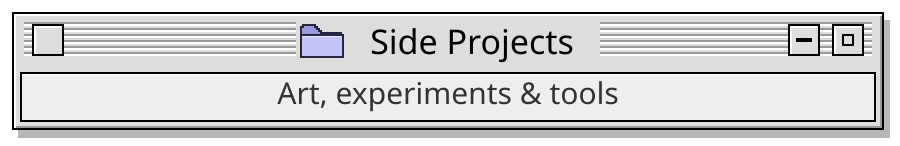
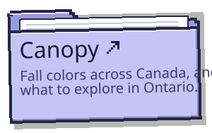
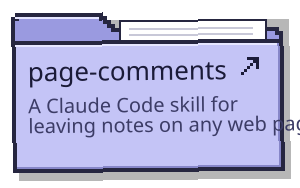
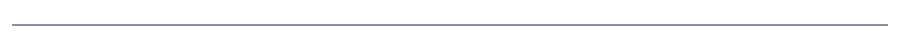
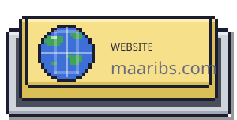
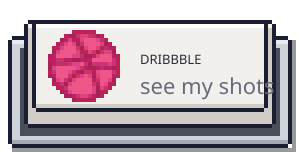

<picture><source media="(prefers-color-scheme: dark)" srcset="assets/intro-dark.svg"></picture>

<picture></picture>

**Product designer who builds.** 12+ years designing for fintech, Web3 and commerce. Based in Toronto.

| World | Teams |
|:--|:--|
| **Fintech** | Glow Finance · Megprime Pay · Concrete Finance · Credit Coop · Goldfinch |
| **Web3** | XMTP · Koop · The Wall Street Journal · DC Pictures |
| **Commerce** | Shop Bonsai · Suntory · Zala Hair · Complex |

<picture></picture>

```console
maarib@design:~$ npm install maarib
+ figma  + claude-code  + react  + next  + tailwind  + coffee
added 312 packages, 1 cat
```

> [!TIP]
> **Wanted:** hard problems in fintech and DeFi. I prototype and ship.

<picture></picture>

<p align="center"><a href="https://maarib.github.io/canopy/"></a><a href="https://github.com/maarib/alert.engine"></a><a href="https://github.com/maarib/page-comments"></a></p>

<picture></picture>

<p align="center"><a href="https://www.maaribs.com"></a><a href="https://www.linkedin.com/in/marib/"></a><a href="https://dribbble.com/maaribou"></a></p>
